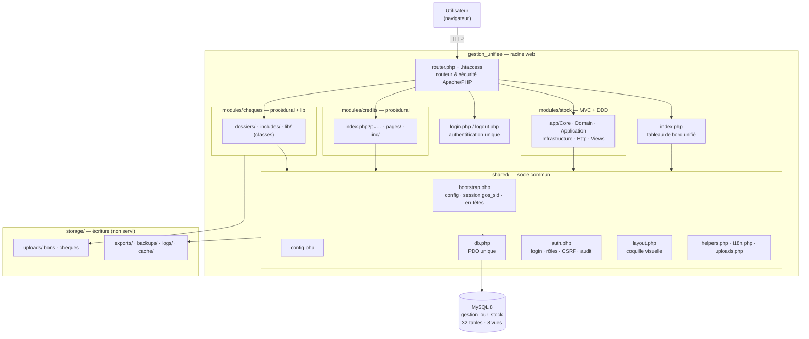
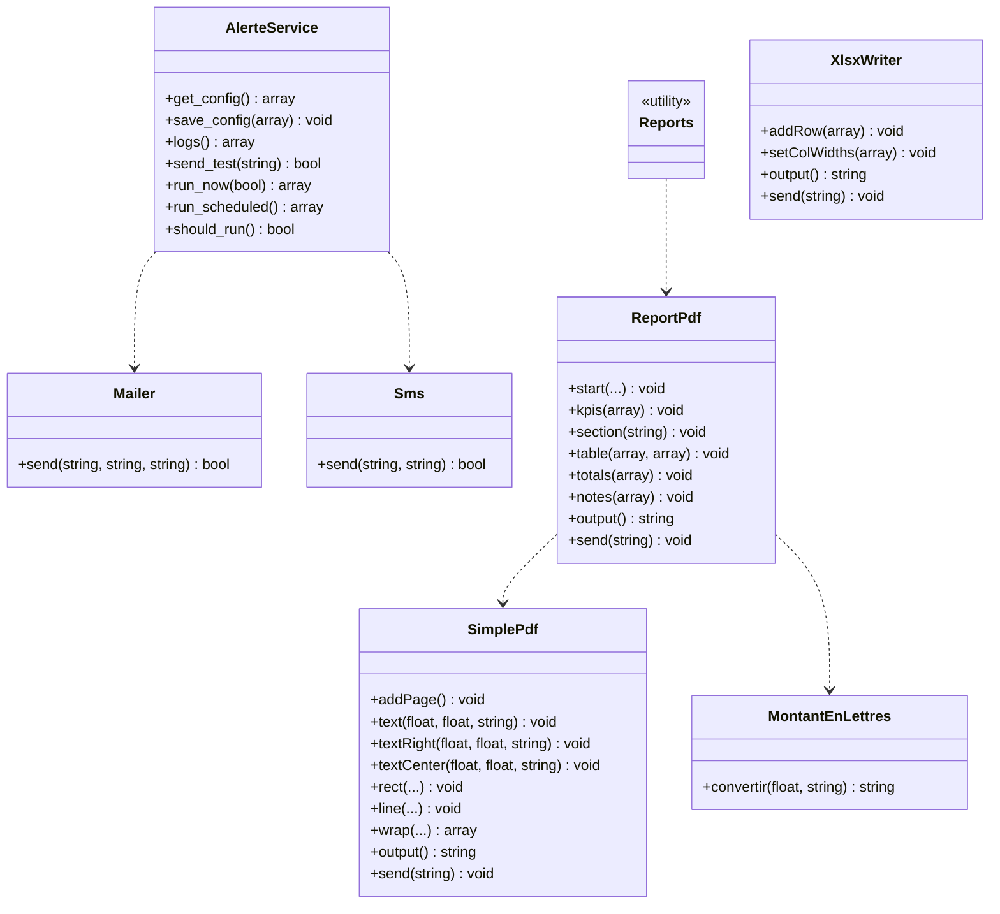
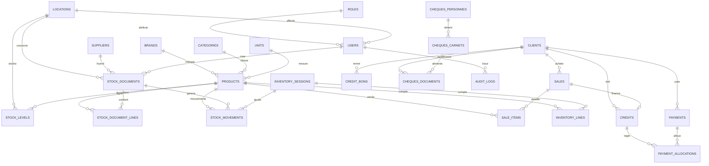
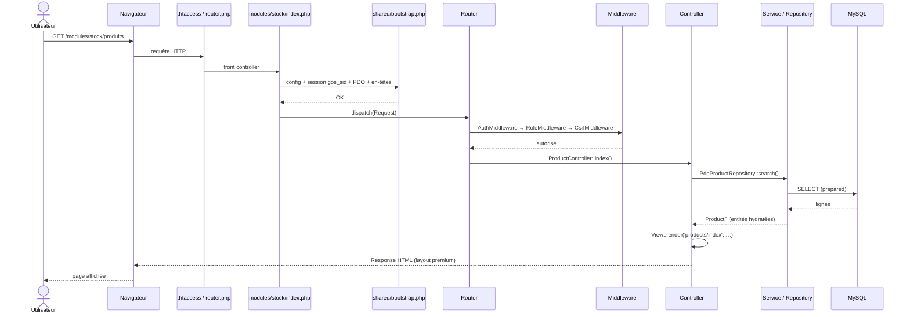
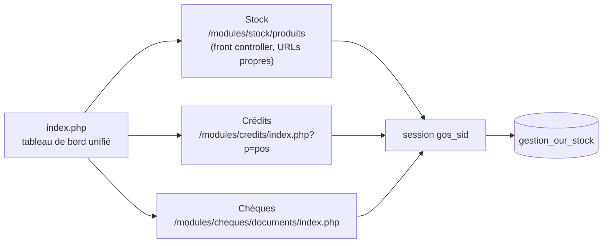

# Architecture — Gestion Our Stock

> Application unifiée : **une base** (`gestion_our_stock`), **une connexion**, **une session**,
> **3 modules** (Stock · Crédits & Ventes · Chèques & Effets).
> Ce document décrit l'architecture technique et fournit les diagrammes (Mermaid — rendus
> automatiquement par GitHub / VS Code).

---

## 1. Vue d'ensemble (contexte & conteneurs)



**Principe clé :** les trois modules ne gèrent plus leur propre session ni leur propre connexion.
Ils appellent tous `shared/bootstrap.php`, qui garantit une session (`gos_sid`), une connexion PDO
et les en-têtes de sécurité communs.

---

## 2. Architecture logique (couches)

```mermaid
graph LR
    subgraph PRES["Présentation"]
        VIEWS["Views / pages / dossiers<br/>HTML + CSS premium"]
        LAYOUT["shared/layout.php<br/>sidebar · topbar · thème"]
    end

    subgraph HTTP["Couche HTTP"]
        FRONT["Front controller<br/>index.php (Stock)"]
        ROUTER["Router<br/>routes + paramètres"]
        MW["Middleware<br/>Auth · CSRF · Role"]
        CTRL["Controllers<br/>Web + Api"]
    end

    subgraph APP["Application / Domaine"]
        SVC["Services<br/>StockService · AuthService"]
        ENT["Entités du domaine<br/>Product · StockDocument · …"]
        REPO["Repositories<br/>Pdo*Repository"]
    end

    subgraph INFRA["Infrastructure"]
        PDO["Database (PDO)"]
        EXP["Export<br/>Csv · Xls · Pdf"]
        LIB["lib/ (chèques)<br/>Pdf · Mailer · Sms · Alerte"]
    end

    DB[("MySQL")]

    PRES --> HTTP --> APP --> INFRA --> DB
```



| Couche | Dossier (module Stock) | Rôle |
|---|---|---|
| Core | `app/Core` | Router, Request, Response, View, Config, Database, Auth, Csrf |
| Domaine | `app/Domain/Entities` | Objets métier immuables (getters) |
| Application | `app/Application/Services` | Cas d'usage transactionnels |
| Infrastructure | `app/Infrastructure/{Persistence,Export}` | Accès BD (PDO) et exports |
| Http | `app/Http/{Controllers,Middleware}` | Entrées web + API REST |
| Vues | `app/Views` | Templates PHP |

> **Les modules `credits` et `cheques` sont procéduraux** (fonctions + pages incluses) : ils ont été
> conservés tels quels pour préserver le comportement métier, et branchés sur le socle `shared/`.

---

## 3. Arborescence

```
gestion_unifiee/
├── index.php                 # Tableau de bord unifié (KPIs des 3 modules)
├── login.php / logout.php    # Authentification unique
├── router.php                # Routeur du serveur PHP intégré (dev)
├── .htaccess                 # Sécurité + front controller Apache (prod)
├── shared/                   # SOCLE COMMUN
│   ├── bootstrap.php         # config, session, en-têtes, dossiers
│   ├── config.php            # config globale (+ config.local.php ignoré)
│   ├── db.php                # core_db() : PDO unique
│   ├── auth.php              # login, rôles, modules, CSRF, audit
│   ├── layout.php            # sidebar / topbar / icônes (gos-*)
│   ├── helpers.php · i18n.php · uploads.php
├── modules/
│   ├── stock/                # MVC + DDD (le plus structuré)
│   │   ├── index.php         # front controller + table de routes
│   │   ├── app/{Core,Domain,Application,Infrastructure,Http,Views}
│   │   └── config/ · database/ · assets/
│   ├── credits/              # procédural : index.php?p=<page>
│   │   ├── index.php · pages/ · inc/{db,helpers,layout,pdf,xlsx}
│   ├── cheques/              # procédural par dossiers + lib/ (classes)
│   │   ├── documents/ · beneficiaires/ · carnets/ · personnes/ …
│   │   └── includes/ · lib/ · api/
├── api/quick_create.php      # création rapide (« + ») transversale
├── database/                 # install · schema.sql · migrations · merge · upgrade · doctor
├── assets/                   # CSS/JS communs (dont premium.css)
├── storage/                  # uploads · exports · backups · logs · cache (non servi)
└── deploy/                   # exemples de configuration serveur
```

---

## 4. Diagramme de classes — module Stock (UML)

```mermaid
classDiagram
    direction LR

    %% ---------------- Core ----------------
    class Config {
        +load(array) void
        +get(string, mixed) mixed
    }
    class Database {
        -PDO pdo
        +pdo() PDO
        +serverPdo() PDO
        +reset() void
    }
    class Router {
        -array routes
        +get(string, handler, array) void
        +post(string, handler, array) void
        +dispatch(Request) Response
    }
    class Request {
        +method() string
        +path() string
        +query(string, mixed) mixed
        +input(string, mixed) mixed
        +all() array
        +isApi() bool
        +ip() string
    }
    class Response {
        +html(string) Response
        +json(mixed, int) Response
        +redirect(string) Response
        +csv(string, string) Response
        +xls(string, string) Response
        +pdf(string, string) Response
        +send() void
    }
    class View {
        +render(string, array, string) Response
    }
    class Auth {
        +check() bool
        +user() array
        +login(string, string) bool
        +logout() void
        +isRole(string) bool
        +id() int
    }
    class Csrf {
        +token() string
        +field() string
        +verify() bool
        +rotate() void
    }

    %% ---------------- Middleware ----------------
    class AuthMiddleware {
        +web() callable
        +api() callable
    }
    class CsrfMiddleware {
        +web() callable
    }
    class RoleMiddleware {
        +web(string) callable
    }

    %% ---------------- Domaine ----------------
    class Product {
        +int id
        +string sku
        +string designation
        +string brand
        +string category
        +string unit
        +float purchaseCost
        +float salePrice
        +float minStock
        +float quantity
        +float stockValue
        +string positions
        +bool active
        +isLowStock() bool
        +isOutOfStock() bool
        +marginRate() float
        +toArray() array
    }
    class Brand {
        +int id
        +string name
        +bool active
    }
    class Category {
        +int id
        +string name
        +bool active
    }
    class Unit {
        +int id
        +string code
        +string label
    }
    class Supplier {
        +int id
        +string name
        +string ice
        +string phone
        +bool active
    }
    class Location {
        +int id
        +string code
        +string name
        +string type
        +bool active
    }
    class StockDocument {
        +int id
        +string type
        +string motif
        +string numero
        +string status
        +int locationId
        +float totalCost
        +float totalSale
        +array lines
    }
    class StockDocumentLine {
        +int id
        +int productId
        +float qty
        +float unitCost
        +float unitPrice
    }
    class StockMovement {
        +int id
        +string direction
        +float qty
        +float unitCost
        +float unitPrice
    }
    class InventorySession {
        +int id
        +string numero
        +string status
        +array lines
    }
    class InventoryLine {
        +int id
        +int productId
        +float theoretical
        +float counted
        +float gap
    }
    class User {
        +int id
        +string name
        +string login
        +string roleCode
        +bool active
    }

    %% ---------------- Repositories ----------------
    class PdoProductRepository {
        +search(term, id, activeOnly, filters) array
        +find(int) Product
        +findRaw(int) array
        +allActiveSimple() array
        +create(array) int
        +update(int, array) void
        +toggle(int) void
        +stats() array
        +stockByLocation(array) array
        +stockByCategory(array) array
        +consultation(array) array
    }
    class PdoReferenceRepository {
        +brands(bool) array
        +categories(bool) array
        +units(bool) array
        +suppliers(bool) array
        +locations(bool) array
        +create(string, array) int
        +toggle(string, int) void
        +exists(string, int) bool
    }
    class PdoDocumentRepository {
        +search(array) array
        +find(int) StockDocument
        +lines(int) array
        +stats() array
        +movements(array) array
        +pendingCounts() int
    }
    class PdoInventoryRepository {
        +search(array) array
        +find(int) InventorySession
        +lines(int) array
        +stats() array
    }
    class PdoSettingsRepository {
        +all() array
        +get(string, string) string
        +setMany(array) void
    }
    class PdoStatisticsRepository {
        +summary(array) array
        +history(array) array
        +categoryBreakdown(array) array
        +topProducts(array) array
    }
    class PdoUserRepository {
        +findById(int) User
        +findByLogin(string) User
        +all() array
        +roles() array
        +create(array) int
        +update(int, array) void
        +toggle(int) void
        +countActiveAdmins() int
    }

    %% ---------------- Services ----------------
    class StockService {
        +createDocument(...) int
        +validateDocument(int, int) void
        +shipTransfer(int, int) void
        +receiveTransfer(int, int) void
        +cancelDocument(int, int, string) void
        +createInventory(int, string, int) int
        +saveInventoryCounts(int, array, int) void
        +validateInventory(int, int) void
        +cancelInventory(int, int) void
    }
    class AuthService {
        +attempt(string, string) bool
    }

    %% ---------------- Controllers Web ----------------
    class DashboardController {
        +index(Request) Response
    }
    class ProductController {
        +index(Request) Response
        +export(Request) Response
        +create(Request) Response
        +store(Request) Response
        +edit(Request, string) Response
        +update(Request, string) Response
        +toggle(Request, string) Response
    }
    class DocumentController {
        <<abstract>>
        +index(Request) Response
        +export(Request) Response
        +create(Request) Response
        +store(Request) Response
        +show(Request, string) Response
        +validateDocument(Request, string) Response
        +cancel(Request, string) Response
    }
    class EntryController
    class ExitController
    class TransferController {
        +ship(Request, string) Response
        +receive(Request, string) Response
    }
    class InventoryController {
        +index(Request) Response
        +create(Request) Response
        +store(Request) Response
        +show(Request, string) Response
        +save(Request, string) Response
        +validateInventory(Request, string) Response
        +cancel(Request, string) Response
    }
    class ConsultationController {
        +index(Request) Response
        +export(Request) Response
    }
    class ReportController {
        +index(Request) Response
        +export(Request) Response
    }
    class StatisticsController {
        +index(Request) Response
        +export(Request) Response
    }
    class ReferenceController {
        +index(Request) Response
        +store(Request, string) Response
        +toggle(Request, string, string) Response
    }
    class SettingsController {
        +index(Request) Response
        +update(Request) Response
    }
    class UserController {
        +index(Request) Response
        +create(Request) Response
        +store(Request) Response
        +edit(Request, string) Response
        +update(Request, string) Response
        +toggle(Request, string) Response
    }
    class AuthController {
        +showLogin(Request) Response
        +login(Request) Response
        +logout(Request) Response
    }

    %% ---------------- Controllers API ----------------
    class HealthController
    class AuthApiController
    class ProductApiController
    class StockApiController
    class DocumentApiController
    class MovementApiController

    %% ---------------- Export ----------------
    class ExportDocument {
        +string filename
        +string title
        +array columns
        +array rows
        +columnCount() int
        +isEmpty() bool
    }
    class CsvExporter {
        +render(ExportDocument) string
    }
    class XlsExporter {
        +render(ExportDocument) string
    }
    class PdfExporter {
        +render(ExportDocument) string
    }

    %% ---------------- Relations : héritage ----------------
    DocumentController <|-- EntryController
    DocumentController <|-- ExitController
    DocumentController <|-- TransferController

    %% ---------------- Relations : noyau ----------------
    Router ..> Request
    Router ..> Response
    View ..> Response
    AuthMiddleware ..> Auth
    CsrfMiddleware ..> Csrf
    RoleMiddleware ..> Auth

    %% ---------------- Relations : controllers -> services/repos ----------------
    ProductController ..> PdoProductRepository
    ProductController ..> PdoReferenceRepository
    ProductController ..> ExportDocument
    ReferenceController ..> PdoReferenceRepository
    DocumentController ..> PdoDocumentRepository
    DocumentController ..> StockService
    TransferController ..> StockService
    InventoryController ..> PdoInventoryRepository
    InventoryController ..> StockService
    ConsultationController ..> PdoProductRepository
    StatisticsController ..> PdoStatisticsRepository
    ReportController ..> PdoDocumentRepository
    SettingsController ..> PdoSettingsRepository
    UserController ..> PdoUserRepository
    AuthController ..> AuthService

    %% ---------------- Relations : services/repos -> infrastructure & domaine ----------------
    StockService ..> Database
    StockService ..> PdoSettingsRepository
    PdoProductRepository ..> Product : hydrate
    PdoReferenceRepository ..> Brand
    PdoReferenceRepository ..> Category
    PdoReferenceRepository ..> Unit
    PdoReferenceRepository ..> Supplier
    PdoReferenceRepository ..> Location
    PdoDocumentRepository ..> StockDocument
    PdoDocumentRepository ..> StockDocumentLine
    PdoDocumentRepository ..> StockMovement
    PdoInventoryRepository ..> InventorySession
    PdoInventoryRepository ..> InventoryLine
    PdoUserRepository ..> User
    ExportDocument <.. CsvExporter
    ExportDocument <.. XlsExporter
    ExportDocument <.. PdfExporter
```



### Légende des relations

| Notation | Sens |
|---|---|
| `A <|-- B` | B hérite de A |
| `A ..> B` | A dépend de / utilise B |
| `A <.. B` | B produit / réalise A |

---

## 5. Diagramme de classes — module Chèques (`lib/`)

Seul le module Chèques possède de vraies classes utilitaires ; le reste est procédural
(pages incluses, fonctions `fetch_one()` / `fetch_all()`).



> Le module **Crédits** expose aussi `inc/xlsx.php` (classe `XlsxWriter`) et `inc/pdf.php`
> (fonctions `pdf_generate()`, `pdf_stream()`, `pdf_button()`…).

---

## 6. Modèle de données (vue entités-relations)

32 tables, 8 vues de compatibilité. Les vues (`document_paiement`, `carnet`, `personne`,
`beneficiaire`, `credits_products`, `audit_log`, `alerte_config`, `alerte_log`) permettent aux
requêtes héritées de continuer à fonctionner sans modification.



### Groupes de tables

| Domaine | Tables |
|---|---|
| Socle partagé | `roles`, `locations`, `users`, `clients`, `brands`, `categories`, `units`, `suppliers`, `products`, `import_map` |
| Stock | `stock_documents`, `stock_document_lines`, `stock_movements`, `stock_levels`, `inventory_sessions`, `inventory_lines`, `document_sequences` |
| Crédits & Ventes | `sales`, `sale_items`, `credits`, `payments`, `payment_allocations`, `credit_bons` |
| Chèques & Effets | `cheques_personnes`, `cheques_carnets`, `cheques_documents`, `cheques_alert_config`, `cheques_alert_log` |
| Paramètres / audit | `settings`, `parametres_societe` (import seul), `audit_logs`, `login_attempts` |

**Règle d'or :** `stock_levels` est la **source de vérité** du stock ; `stock_movements` est le
**journal** (reconstruit par `database/backfill_stock_movements.php`).

---

## 7. Cycle d'une requête (diagramme de séquence)



---

## 8. Sécurité & cloisonnement

| Mécanisme | Mise en œuvre |
|---|---|
| Session unique | `shared/bootstrap.php` — cookie `gos_sid`, `HttpOnly`, `SameSite=Lax`, `strict_mode` |
| Expiration | inactivité (`session.lifetime`), sinon `core_logout()` + redirection |
| Mots de passe | `password_hash()` (bcrypt), compatibilité anciens hashs Spring Boot `{bcrypt}$2a$…` |
| Anti-bruteforce | table `login_attempts` + verrouillage (`security.max_login_attempts`) |
| CSRF | `core_csrf()` / `core_verify_csrf()` + `CsrfMiddleware` sur chaque POST |
| Rôles | `roles` + `users.modules` ; `core_can_access()` / `RoleMiddleware` |
| En-têtes | CSP, `X-Frame-Options: DENY`, `nosniff`, HSTS (HTTPS), `no-store` |
| Dossiers sensibles | `shared/`, `database/`, `storage/` bloqués par `.htaccess` (`RewriteRule … [F,L]`) |
| Fichiers sensibles | `*.sql`, `*.log`, `*.zip`, `.env*` interdits par `.htaccess` |
| Images | `storage/uploads/…` servies uniquement via des endpoints authentifiés |
| Audit | `audit_logs` (action, entité, IP, user-agent) + vue `audit_log` |

---

## 9. Multi-modules : comment ils cohabitent



| Module | Style | Routage | Accès |
|---|---|---|---|
| Stock | MVC/DDD (classes) | Front controller + `Router` (`/produits`, `/entrees`…) | `core_can_access('stock')` |
| Crédits | Procédural | `index.php?p=<page>` | `core_require_login('credits')` |
| Chèques | Procédural par dossiers | `/documents/index.php`, `/beneficiaires/…` | `require_login()` (socle) |

---

## 10. Base de données — cycle de vie

```mermaid
graph LR
    A["database/install.php --fresh<br/>crée les 32 tables + vues"] --> B["database/migrate_legacy.php --force<br/>import legacy (TRUNCATE + reimport)"]
    B --> C["database/import_gestionmystock.php<br/>import POS (import_map)"]
    C --> D["database/merge_legacy_dumps.php<br/>fusion additive & idempotente"]
    D --> E["database/backfill_stock_movements.php<br/>reconstruit le journal"]
    E --> F["database/upgrade.php<br/>mises à niveau idempotentes"]
    F --> G["database/doctor.php<br/>diagnostic (tables, vues, admin)"]
    G --> H["database/backup.php<br/>dump .sql complet"]
```



> ⚠️ Ne jamais relancer `install.php --fresh` après un import : cela **efface** les données.

---

*Document généré pour le projet Gestion Our Stock — voir aussi `README.md` et `DEPLOIEMENT.md`.*
